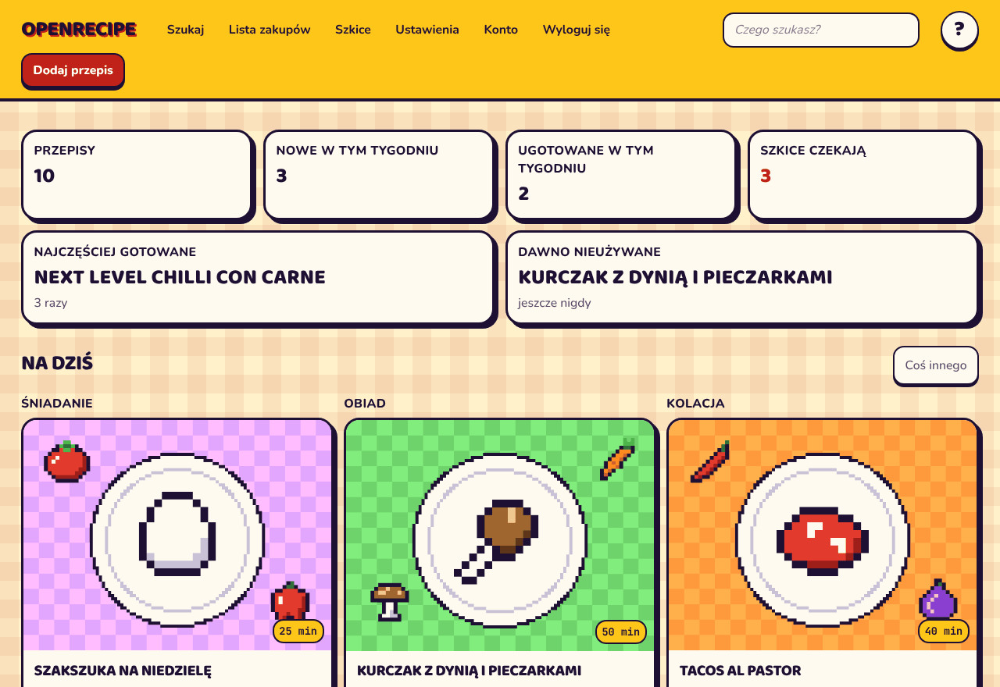
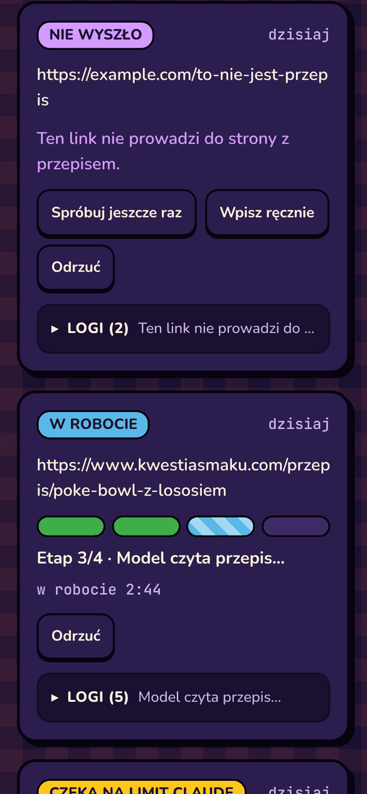
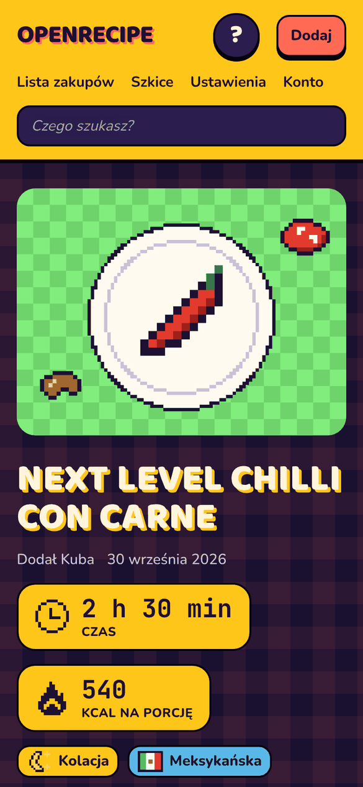
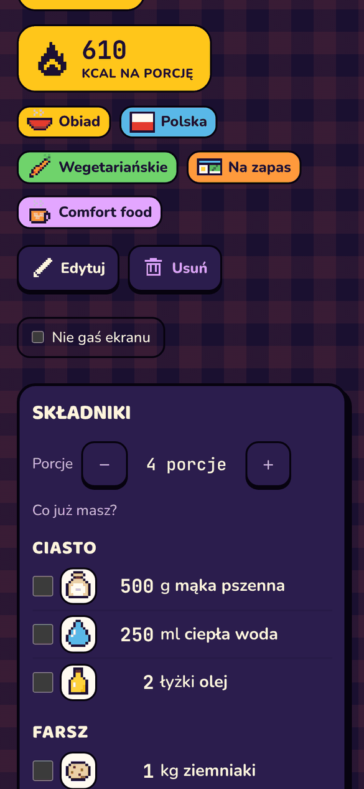
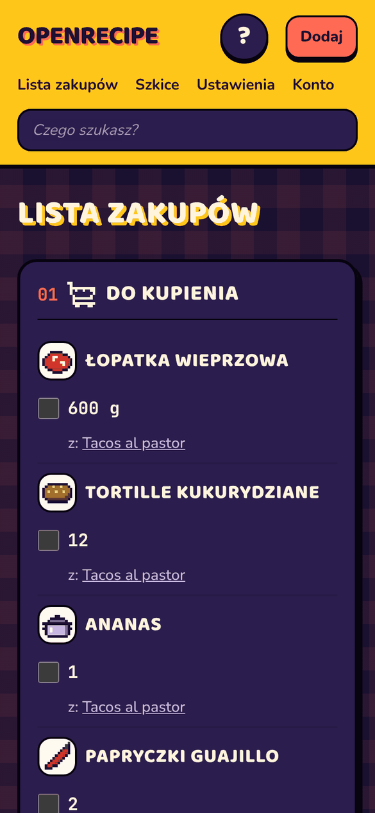
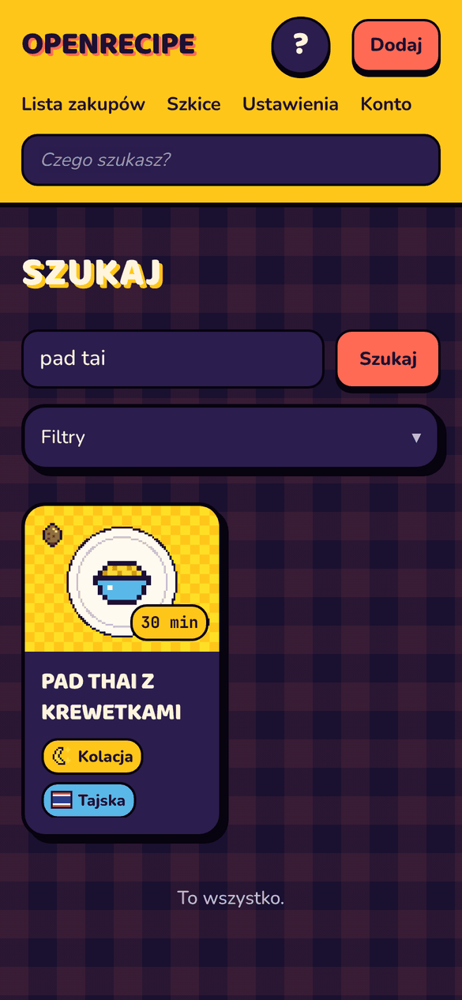
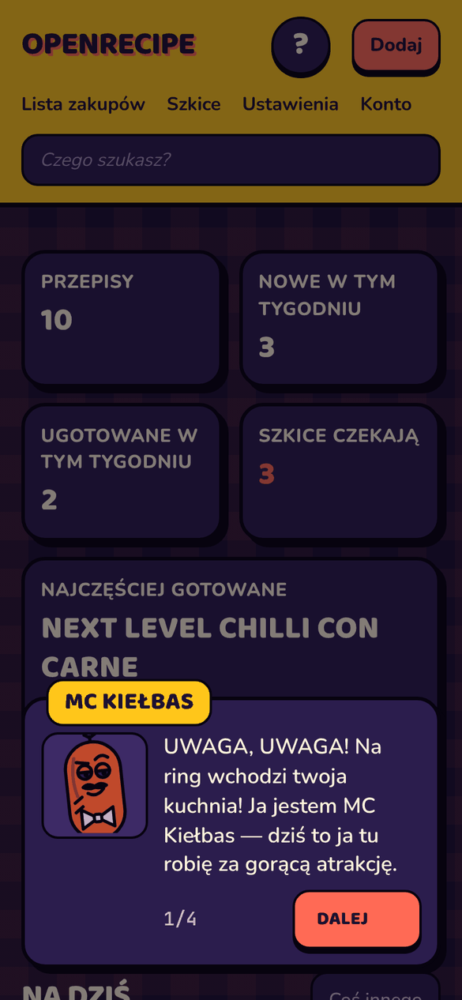
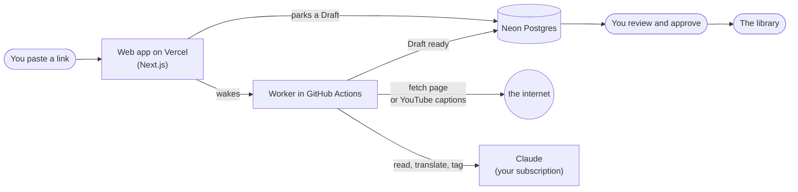

<p align="center">
  
</p>

<h1 align="center">OpenRecipe</h1>

<p align="center">
  <b>A recipe arcade for one hungry household.</b><br />
  Paste a link, let the robot do the boring bit, cook from your phone.
</p>

<p align="center">
  
</p>

You know the drill. Somebody sends a recipe link. It's buried under 4,000 words about
a grandmother's village, three pop-ups and an autoplaying video. It's in English and
your mum reads Polish. You bookmark it, and it's never seen again.

**OpenRecipe** is the place those links go to become actual recipes: translated,
tidied, tagged, and sitting in one private library the whole household can cook from.
It looks like a cartoon game you can cook from (thick ink outlines, juicy colours,
chunky buttons that press in), it speaks cheeky Polish, and it's hosted by a sausage
in a bow tie. More on him later.

It's private and invite-only: one household, no sign-up page, no ads, no SEO, no
growth hacking. It also costs **£0 a month** to run.

> The screenshots use sample recipes, and the pixel-art plates stand in for food photos.

## What it does

### 🔗 Paste a link, go put the kettle on

Drop a link from any recipe site (or a YouTube cooking video) on the **Szkice** (Drafts)
screen. A worker wakes up in GitHub Actions, fetches the page, and hands it to Claude,
which:

- pulls out the ingredients and steps, even from sites with no structured data at all
  (looking at you, most Polish recipe blogs);
- translates everything into Polish;
- picks Tags from your own list;
- suggests **substitutes** for ingredients ("no feta? use labneh");
- flags anything it had to *guess*, like a serving count the page never stated.

Every step lands in a live log on the draft, so it's never a black box. If the Claude
subscription hits its usage limit mid-import, the draft simply waits for the reset and
tries again by itself.

<p align="center">
  
</p>

Nothing goes into the library until a human has looked at it. The review screen is the
normal recipe editor, with the model's guesses marked **zgadywane** so you know where
to look twice.

### 🍳 Cook from your phone

<p align="center">
  
  &nbsp;
  
</p>

- **Time and kcal** on gold scoreboard tiles, because that's what decides tonight's dinner.
- **Tags with pixel icons**: a flag for every cuisine, a fried egg for breakfast, a snail
  for slow-cooked, a jar of pickles for *Na kaca* (hangover cure).
- **Scale servings** up or down and every quantity follows.
- **"Co już masz?"** (What have you got?): tick off what's already in the cupboard. It
  works with no signal, in the back of a shop.
- **Keep the screen awake** while your hands are covered in flour.
- Every ingredient gets a little sprite, picked from its Polish name.

### 🛒 One shopping list for the whole house

Add a recipe to the list at whatever serving size you're cooking. Quantities from
different recipes are merged, anything you've already ticked off at home is left out,
and the list is shared, so whoever is in the shop sees the same ticks.

<p align="center">
  
</p>

### 🔎 Search that forgives your spelling

Typos, missing Polish letters, half-remembered names: `pad tai`, `zurek`, `piza` and
`pierogii` all land on the right recipe. Filter by meal, cuisine, diet, effort or vibe.

<p align="center">
  
</p>

### 🎲 "Na dziś": what's for dinner?

The start screen suggests a breakfast, a lunch and a dinner for today. It skips anything
you cooked in the last week and never shows the same recipe twice. Don't fancy any of
them? **Coś innego** (something else) rerolls.

### 🌭 Meet MC Kiełbas

Every screen has a **?** button. Press it and MC Kiełbas, a smug sausage in a bow tie
who announces like a fighting-game MC, explains what the screen does. Loudly, cheekily,
and always accurately.

<p align="center">
  
</p>

### 📱 There's an Android app

A native Android app (Expo) with the same screens, push notifications when a draft is
ready, and "Share to OpenRecipe" from any app's share sheet. It's sideloaded from
GitHub Releases and tells you when a new version is out.

## How it works



**The house rules** (each one has an [ADR](./docs/adr/) explaining why):

- **£0 a month.** Vercel Hobby, Neon's free Postgres, the free Vercel Blob allowance,
  free GitHub Actions minutes.
- **No AI API key anywhere.** The deployed app never calls a model. The worker uses a
  Claude *subscription* token from `claude setup-token`, so imports are covered by the
  plan instead of billed per call.
- **Polish on screen, English in code.** Every word a person reads lives in one file,
  `packages/core/src/copy.ts`.
- **Every state is designed:** empty, loading, error, offline and partial alike.

---

## Under the hood

- **[PRD.md](./PRD.md)**: what we're building and why
- **[CONTEXT.md](./CONTEXT.md)**: the glossary. Use these words in code, commits and tickets.
- **[docs/adr/](./docs/adr/)**: decisions, with the reasoning that would otherwise be lost

### Stack

Next.js 16 (App Router) · TypeScript · Tailwind 4 · Neon Postgres + Drizzle ·
Better Auth · Vercel Blob. A separate Worker does all LLM work, in GitHub Actions or on a
laptop — see [ADR-0002](./docs/adr/0002-ai-runs-on-a-local-worker.md) and
[ADR-0006](./docs/adr/0006-worker-runs-in-github-actions.md).

### Local

```bash
pnpm install
cp apps/web/.env.example apps/web/.env.local
pnpm dev
```

Fill in `apps/web/.env.local` — each variable says which ticket needs it.

### Database

Schema is TypeScript in [`apps/web/lib/db/schema.ts`](./apps/web/lib/db/schema.ts); migrations are generated
SQL files under `apps/web/drizzle/`, committed and reviewed like any other code.

```bash
pnpm db:generate
```

Diffs the schema and writes a new migration. Works offline — no `DATABASE_URL` needed.

```bash
pnpm db:migrate
```

Applies pending migrations to whatever `DATABASE_URL` points at.

`drizzle-kit push` is deliberately not wired up: it mutates the database without leaving a
migration behind, and drift you cannot read in a diff is drift you cannot reason about six
months later.

Scripts: `dev`, `build`, `start`, `lint`, `typecheck`, `test`.

### Conventions

**Tests.** `node:test` with Node's native type stripping — no framework, no transpile.
`pnpm test` runs every workspace's tests: `apps/web/lib/**/*.test.ts` and
`packages/core/src/**/*.test.ts`.

**Relative imports inside `lib/` and `packages/core` carry the `.ts` extension** (`./copy.ts`). Node strips
types but does no extension resolution, so anything reachable from a test must be imported
that way. Turbopack and `tsc` both accept it (`allowImportingTsExtensions`). App code
imports through the `@/` alias without an extension, as usual; shared code through
`@openrecipe/core/<module>` (also without one).

**Layout.** pnpm workspace: `apps/web` (Next.js, Vercel Root Directory), `apps/mobile`
(Expo, [ADR-0007](./docs/adr/0007-native-android-app.md)), `packages/core` (pure TS both
share — no DB, no Node built-ins, no Next).

**No user-facing string in a component.** Everything readable comes from
[`packages/core/src/copy.ts`](./packages/core/src/copy.ts); formatting from
[`packages/core/src/format.ts`](./packages/core/src/format.ts).

**No hex colour in a component.** Palette tokens live in
[`apps/web/app/globals.css`](./apps/web/app/globals.css).

### CI

[`.github/workflows/ci.yml`](./.github/workflows/ci.yml) runs on every push to `main`
and every PR: install (frozen lockfile), lint, typecheck, test, build.

### First run on an empty database

Accounts only exist via an Invite, and minting one needs a signed-in Master — circular
when nobody exists yet. This opens that door once:

```bash
MASTER_PASSWORD='choose-something' pnpm bootstrap-master
```

It reads `MASTER_EMAIL` from the environment, refuses to overwrite an existing account, and
takes the password from the environment rather than an argument so it stays out of `ps` and
your shell history. Then sign in and mint Invites from `/settings`.

### The Worker

Imports never run on Vercel ([ADR-0002](docs/adr/0002-ai-runs-on-a-local-worker.md)). The
app wakes the Worker in GitHub Actions the moment a link is parked, with a 30-minute cron as
the safety net ([ADR-0006](docs/adr/0006-worker-runs-in-github-actions.md)). The same Worker
runs on a laptop too — park a link at `/drafts`, then drain the queue here:

```bash
pnpm worker
```

It needs `DATABASE_URL` and `BLOB_READ_WRITE_TOKEN`, both already in `.env.local`. It touches the `draft` table only: claims one queued row at a time with a
conditional `UPDATE … for update skip locked`, so two Workers running at once never take the
same row, and reclaims anything left in `processing` for more than ten minutes by a laptop
that got closed. With an empty queue it prints `nothing to do` and exits, so running it on a
whim costs nothing.

To get an Android push when a Draft finishes, set `FIREBASE_SERVICE_ACCOUNT` (the whole Firebase
service-account JSON as one string) wherever the Worker runs: the `FIREBASE_SERVICE_ACCOUNT`
GitHub Actions secret for the cloud Worker, `apps/web/.env.local` for the laptop one. Unset, the
Worker just skips notifications.

What it does per Draft: fetch the page, read its JSON-LD if it publishes any, otherwise keep
the readable text, hand either to Claude through the Agent SDK — which uses the CLI's own
subscription, so there is no API key here or on Vercel — and store the result as `ready` for
review. The model runs on both paths: a JSON-LD page still arrives in the wrong language,
with no Tags and no Substitutes. If it fails on a structured page, the Draft is still saved
from the page's own data, untranslated, rather than thrown away.
Every failure ends with the row moved to `failed` and a Polish reason on it — never a row
stranded in `processing`.

Worth knowing: **most Polish recipe sites publish no `@type: Recipe` structured data.**
Kwestia Smaku and Ania Gotuje both fall to the readable-text path, so the model call (OR-42)
is what makes them work, not a nicety on top.

### Android app

`apps/mobile`, Expo with a dev build (ADR-0007). Run everything from the repo root:

- `pnpm build-mobile` — native build onto the emulator or a USB phone (prebuild + Gradle, JDK 17).
  Needed once, and again after adding a native module or changing `app.json`.
- `pnpm mobile` — the dev server for that build. After changing `tailwind.config.js` or
  `global.css`, start it with a cleared cache: `cd apps/mobile && npx expo start -c`.
- `apps/mobile/.env` sets `EXPO_PUBLIC_API_URL`: the laptop's LAN address in dev (a phone
  can't reach `localhost`), the production URL for a release.
- `apps/mobile/google-services.json` is required by the build (push notifications). Download
  it from the Firebase console, Android app `app.openrecipe.android`. It is not a secret and
  is committed. The Worker's half is `FIREBASE_SERVICE_ACCOUNT` (see The Worker).

#### Releasing

Cut a release by pushing a tag; `.github/workflows/mobile-release.yml` builds the signed
APK and attaches it to a GitHub Release as `openrecipe.apk`:

```sh
git tag mobile-v1.0.0 && git push origin mobile-v1.0.0
```

The tag gives `versionName` (1.0.0); the run number gives `versionCode`. The stable link
(also behind the public `/app` page) is
`https://github.com/michynow/openrecipe/releases/latest/download/openrecipe.apk`.

One-time setup, in GitHub > Settings > Secrets and variables > Actions:

- Secrets: `ANDROID_KEYSTORE_BASE64`, `ANDROID_KEYSTORE_PASSWORD`, `ANDROID_KEY_ALIAS`,
  `ANDROID_KEY_PASSWORD`.
- Variable: `EXPO_PUBLIC_API_URL` = the production URL (the build fails if it is empty).

Generate the keystore once, then base64 it for the secret (macOS):

```sh
keytool -genkeypair -v -storetype PKCS12 -keystore openrecipe-release.keystore \
  -alias openrecipe -keyalg RSA -keysize 2048 -validity 10000
base64 -i openrecipe-release.keystore | pbcopy
```

**Lose the keystore and installed apps can never be updated** (Android refuses a different
signature). Keep a backup outside the repo and never commit it (`*.keystore` and `*.jks`
are gitignored).

### Where the build is

Phases 0 to 5 from PRD §14 are built. What that means in practice: sign in, type a
Recipe or park a link, let `pnpm worker` turn it into a Draft, review what the model
guessed, approve it, cook from your phone, search with typos, and see what the household
has been cooking.

Phase 6 — the polish pass over states, accessibility, motion and 375px — is deliberately
still open, and so is the wider UI rework that supersedes part of it.

Two things still need a person rather than a commit: linking the repo to Vercel so
production deploys on push (OR-8), and finishing the Better Auth Google setup against the
production URL (OR-11).

### Deploys

Deploys are owned by **Vercel's Git integration**, not by CI — so there are no
deploy tokens in this repo and preview deploys come free on every PR.

One-time setup: Vercel → Add New → Project → import `michynow/openrecipe`. Framework
detects as Next.js. Then add the environment variables listed in PRD §15.

Push to `main` → production. Open a PR → preview URL on the PR.

### Working agreement

Build order and the Jira tracking rules live in PRD §14 and §17. Short version: one
ticket in progress at a time, its status always reflects reality, and an Epic closes only
when every child is genuinely done.
